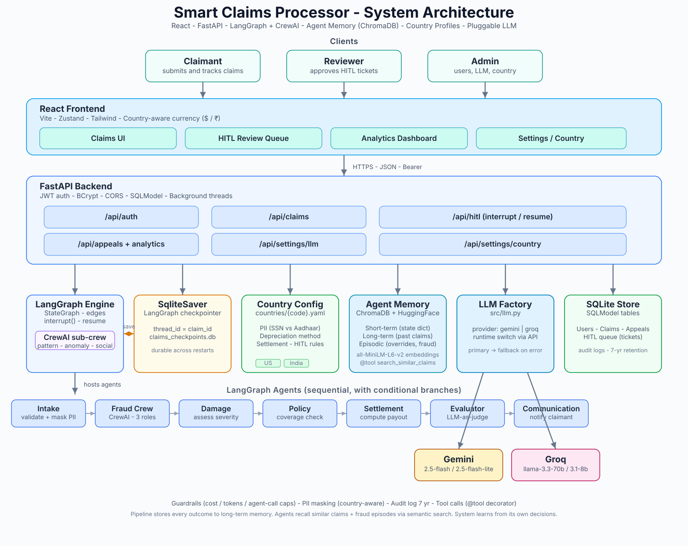
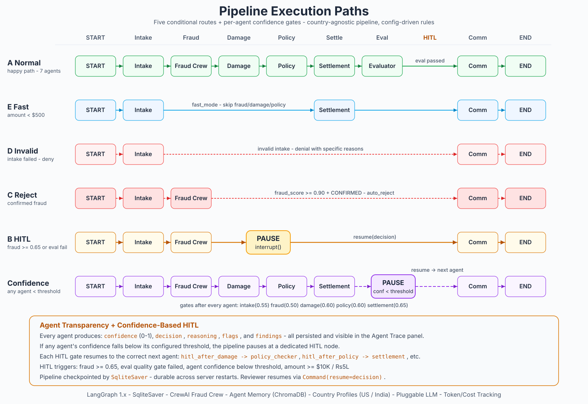

# Smart Claims Processor

A multi-agent insurance claims pipeline built with **LangGraph** (orchestration) and **CrewAI** (a fraud-detection sub-crew). A claimant submits a claim through a React UI; the backend runs it through specialist agents — intake validation, damage assessment, policy compliance, fraud detection, settlement calculation, and LLM-as-judge evaluation — before a claimant notification goes out. Risky, high-value, or low-confidence claims pause for a human reviewer instead of auto-deciding.

This repo started from a reference implementation and was substantially rebuilt: every agent's prompt and hard-rule enforcement was redesigned, the fan-out/consistency-check architecture was rebuilt around real parallelism, and a full offline evaluation layer (judge calibration, trajectory conformance, task-completion-rate against purpose-built test fixtures) was added on top. See [`CLAUDE.md`](CLAUDE.md) for the complete, dated build log of every design decision, bug found, and fix made.

---

## Why this exists

Most "multi-agent demo" repos stop at wiring agents together and calling it done. The harder, less-demoed part is everything *around* the agents: can you trust a confidence score, does a human-review gate actually gate anything, what happens when your API quota runs out mid-run, how do you know the system's decisions are *correct* rather than merely *well-formatted*. This project treats those as the actual engineering problems, not an afterthought:

- **Code decides, LLMs judge.** Settlement arithmetic, routing between agents, and hard business rules (total-loss thresholds, deductible math, exclusion matching) are code. LLMs are only asked questions code genuinely can't answer — does this narrative describe racing, is this reasoning transparent, would a human adjuster agree with this amount.
- **Confidence never bypasses a human by itself.** A low-confidence agent output only ever re-sorts an already-flagged human-review queue; it never silently waves a claim through or silently blocks one.
- **A pause is correct behavior, not a failure.** Across this session's live test runs, most claims that paused did so for an explainable, intended reason (a real fraud-adjacent signal, a value threshold, a security fail-safe tripping under real API rate pressure) — see [Evaluation](#evaluation) for how that's actually verified, not assumed.
- **Every claim found "incorrect" during testing was investigated, not just counted.** Several apparent test failures turned out to be the grading script's own wrong assumption, not a system defect — see `CLAUDE.md`'s rebuild log for the specific cases.

---

## Architecture





**Pipeline, in order:**

1. **`intake_agent`** — validates the claim (policy exists and is active, claim type matches coverage) with code-computed `is_valid`, not an LLM guess. A dedicated classifier checks for prompt-injection attempts in the narrative, independently from a separate `/verify-type` endpoint that checks the claimant's chosen incident type against their own description *before* submission.
2. **Routing** — an invalid claim or injection attempt routes straight to denial or mandatory human review. A claim under the fast-mode threshold skips the expensive analysis entirely. Otherwise, three agents run **in real parallel fan-out**:
3. **`damage_assessor`** — grounds its repair-cost estimate in the real repair-estimate document's line items when one exists; otherwise flags `requires_physical_inspection` rather than guessing. A code-enforced hard rule decides repair-vs-total-loss from the repair/ACV ratio, overriding the LLM if it disagrees with the computed number.
4. **`policy_checker`** — matches policy exclusions (racing, commercial use, pre-existing damage) against the claim narrative using explicit, narrow criteria (what counts, and what superficially-similar wording does *not* count) — not a keyword match.
5. **`fraud_crew`** — a 3-agent CrewAI sub-crew (pattern analyst, anomaly detector, consistency validator) producing a composite fraud score in code from the three agents' outputs.
6. **`consistency_coordinator`** — cross-checks the three fan-out agents' outputs against each other for missed facts or severity mismatches the independent agents could create by not seeing each other's work. A real conflict triggers one bounded retry (cap 2) of the specific agent that needs to reconsider; a cosmetic conflict is logged but never retried.
7. **`settlement_calculator`** — gross damage minus depreciation minus deductible, capped at the coverage limit. The arithmetic is code; the LLM explains it.
8. **Human-in-the-loop gates** — a claim pauses for human sign-off whenever: fraud score ≥ 0.45, any agent's confidence < 0.60 *combined with* a high-impact claim amount (confidence alone never gates), the claim amount is at or above the country's real high-value threshold ($84,100 in the US profile, the 90th percentile of real claim amounts), or a policy exclusion/physical-inspection condition fires. Every pause is backed by `LangGraph`'s `interrupt()`, durably checkpointed by `SqliteSaver` — a reviewer's decision resumes the exact paused state, not a replay from scratch.
9. **`evaluator`** — grades the completed decision before release: `accuracy` is code-verified (does the settlement respect its own invariants), `fairness` and `transparency` are two *isolated* LLM-judge calls (never one combined multi-dimension call — see [Evaluation](#evaluation)). A failed quality gate pauses for review instead of auto-releasing.
10. **`communication_agent`** — sends the claimant's final notification, with a code-level backstop that strips any fraud-related language a human shouldn't see before a reviewer has acted.

**Guardrails** (`src/guardrails/manager.py`) wrap every node: a hard cap on agent calls, tokens, cost, and active processing time per claim. A breach halts the claim to a human with zero further LLM spend — this is itself one of the 31 architecturally distinct branches this project tests (see below).

---

## Evaluation

Three genuinely different questions, each answered by a different mechanism — conflating them produces a misleading "it works" claim, so this project keeps them explicitly separate:

| Question | Mechanism | Status |
|---|---|---|
| Is the architecture wired correctly? | `tests/test_scenarios_e2e.py` — 30 mocked tests, one per distinct routing branch, driving the real compiled LangGraph graph with every LLM call mocked (part of the full 294-test suite covering every module). Zero LLM calls, zero cost, runs in CI on every push. | ✅ 294/294 passing overall, 30/30 on the branch-coverage suite specifically |
| Does live LLM reasoning land where the architecture expects? | `data/test_scenarios/` (30 hand-built fixtures, one per branch) run against the real model. All 31 architectural branches (30 content-driven + the guardrail-halt/resume pair, which needs a temporary config override rather than claim content) live-verified with real Gemini calls. | ✅ 31/31 branches live-verified |
| Are the judges themselves trustworthy? | `evaluation/judge_golden_set.py` + `validate_judges.py` — 14 hand-labeled cases run through the real `fairness`/`transparency`/conflict-detection judges, graded against known-correct labels. | 11/14 (79%) agreement — one real miscalibration found and diagnosed (a judge's own stated reasoning didn't match its score, a known LLM-judge failure mode) |
| Does the system reach the *correct* outcome across many realistic, rule-targeted claims? | `data/test_set_100/` — 100 claims, 17 categories, each built to exercise one specific enforced rule (not just "realistic variety"), grounded in real Kaggle/Mendeley claim data where real data exists and synthetically constructed where it doesn't (policy exclusions and fraud-classification narratives have no public dataset — checked two real candidates before concluding this, see `CLAUDE.md`). Run via `scripts/run_100_test_set.py`. | In progress — only a partial run has completed so far, and that partial run was itself contaminated by real API quota exhaustion (see below). Numbers from this eval are intentionally **not yet shown anywhere**, including the in-app Evals dashboard, until a full clean run exists. |

**Trajectory evaluation** (`evaluation/trajectory.py`) is a fourth, separate layer: did a claim take the *correct path* through the graph, not just land on a correct final answer — catching "right answer, wrong route" failures that outcome-only grading misses. Pure code (path-conformance diff, step-efficiency ratio, retry-recovery classification), no LLM judge. Deliberately does **not** attempt to grade tool-selection or parameter accuracy, since this architecture's routing is 100% code-decided — there's no LLM here that freely picks a tool, so there's nothing for that metric to measure.

**A real, honest finding from this work**: a batch run's "40% correct" result turned out to be almost entirely one thing — a real Google API rate-limit error hitting the prompt-injection classifier, which by design fails toward caution (treats its own failure as a possible injection attempt rather than silently skipping the check) and pauses the claim for review, regardless of what the claim was actually built to test. That's correct security behavior under a real failure condition, not a pipeline defect — but it meant the batch's raw percentage didn't actually measure what it looked like it was measuring. This project treats that distinction as load-bearing: a percentage without its failure mode investigated is not a trustworthy percentage.

In-app: the **Evals** page (reviewer/admin role) surfaces the clean, already-complete evaluations above — judge calibration and the 30-claim flow-verification batches. It does not show the in-progress 100-claim eval until that run is genuinely finished, on purpose.

---

## Prerequisites

- Python 3.11+
- Node.js 18+
- One LLM API key — [Groq](https://console.groq.com/keys) (free) or [Gemini](https://aistudio.google.com/app/apikey) (free tier, rate-limited per-model, not pooled — see `configs/base.yaml`'s own comments on this if you hit a 429)

---

## Quickstart

```bash
# 1. Clone and open in your editor
git clone <this-repo-url>
cd smart-claims-processor

# 2. Backend: venv + deps
python -m venv .venv
.venv\Scripts\activate        # Windows
# source .venv/bin/activate   # macOS/Linux
pip install -r requirements.txt
# First install takes a few minutes - sentence-transformers pulls PyTorch +
# the all-MiniLM-L6-v2 embedding model (~80 MB, cached after first run).

# 3. Configure
cp .env.example .env
# Edit .env: set LLM_PROVIDER and the matching API key.
# Generate a real JWT signing key:
python -c "import secrets; print(secrets.token_urlsafe(32))"
# paste the output next to API_SECRET_KEY= in .env

# 4. Seed test policies (valid coverage dates, so claims submit cleanly)
python scripts/seed_policies.py

# 5. Start the backend
uvicorn api.main:app --port 8000

# 6. In a second terminal: frontend
cd frontend
npm install
npm run dev
```

Backend: `http://localhost:8000` (`/docs` for the OpenAPI UI). Frontend: `http://localhost:3000`, proxies `/api` to the backend. Seeded dev login: `admin` / `admin123` — **change or delete before any non-local deployment.**

---

## Running Tests

```bash
pytest -q
```

294 tests, all mocked — no API key required, no network calls, runs in well under a minute. This is the architecture-correctness suite (every distinct routing branch, driven through the real compiled graph). It does not spend LLM quota and does not by itself confirm live model reasoning lands where expected — see [Evaluation](#evaluation) for that layer.

To run a real, quota-spending eval batch:

```bash
python scripts/run_live_batch.py scenarios1        # 10 of 30 test_scenarios, real LLM calls
python scripts/run_100_test_set.py 5 1             # batch 1 of 20, 5-claim batches
```

---

## Switching LLM Provider

Set in `.env`, or at runtime via `PUT /api/settings/llm` (admin only):

```bash
LLM_PROVIDER=gemini      # or groq
GOOGLE_API_KEY=...       # matching key
```

Per-provider model, fallback model, and judge model are configured in `configs/base.yaml` → `llm.providers.<name>`. A call that fails on the primary model automatically retries on `fallback_model` (`LangChain`'s `with_fallbacks`) — tested live this session against a real daily-quota exhaustion and a real fallback-timeout condition, both diagnosed and fixed rather than assumed to just work.

---

## Country Profiles

`configs/countries/<code>.yaml` sets currency, PII field lists, depreciation method, settlement rules, and HITL thresholds per country. Set `COUNTRY=us` or `COUNTRY=india` in `.env`. The US profile's `$84,100` high-value threshold is the real 90th percentile of claim amounts in the dataset this project's test data is built from — not an arbitrary round number.

---

## API at a Glance

| Prefix | Covers |
|---|---|
| `/api/auth` | Login, JWT issuance, user management |
| `/api/claims` | Submit, list, claim status, `/verify-type` pre-submission check |
| `/api/hitl` | The human-review queue: list pending, `POST /decide/{ticket_id}` to approve/deny/override — this is what actually resumes a paused claim |
| `/api/appeals` | Appeal a denied claim |
| `/api/policies` | Policy CRUD (admin) |
| `/api/analytics` | Live production metrics: approval rate, cost, fraud trends, HITL rate |
| `/api/evals` | Offline eval results (judge calibration, flow-verification batches) — deliberately separate from `/api/analytics`, which reads live claim data, not test-run results |
| `/api/settings` | Runtime LLM provider/model override |

Full interactive reference at `/docs` once the backend is running.

---

## Project Layout

```
api/            FastAPI app: routes, auth, DB models
src/
  agents/       The 7 pipeline agents + graph.py (LangGraph wiring, routing, guardrail node)
  data/         Real-dataset loading + synthetic test-fixture generation (selection.py, generate.py)
  evaluation/   evaluator.py - the live per-claim quality judge
  guardrails/   Per-claim cost/call/token/time caps
  security/     PII masking, prompt-injection detection, audit log
  memory/       Three-tier agent memory (ChromaDB + HuggingFace embeddings)
  tools/        Damage/depreciation calculators, bounded tool-calling loop for memory lookups
evaluation/      Offline eval scripts: judge golden set, judge validation, model-swap regression check
scripts/         Live-batch runners, policy seeding, dataset generation entry points
data/
  test_scenarios/      30 hand-built fixtures, one per architectural routing branch
  test_set_100/        100 claims, 17 rule-driven categories, grounded in real + synthetic data
  stratified_claims/   47 claims from the real dataset (secondary - realistic variety, not full coverage)
  large_nonfraud_claims/  100 more of the same (secondary, same reason)
  batch_results/       Saved JSON output from every real eval run this project has done
frontend/        React + Vite + MUI; mirrors the full API surface
tests/           294 mocked architecture tests
```

See [`CLAUDE.md`](CLAUDE.md) for the complete rebuild history: every agent redesign, every bug found and fixed, and the reasoning behind every architectural decision, in the order it actually happened.

---

## License

MIT
